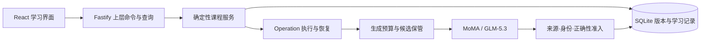

# Study Clinic 系统架构

适用版本：V2（2.0.0）。

[首页](../README.md) · [运行](SETUP.md) · [产品与评测](REPORT.md)

本文依据已验收V2源码。schema版本7；生产只装配routes/clinic.ts。历史Hy3架构正文固定在[整理前快照](https://github.com/Small-fish-QAQ/hy3-study-clinic/blob/9ec6bde693455eac3df00e33984d9e0e0d9d8c93/docs/ARCHITECTURE.md)，其旧API不属于当前运行合同。

## 持久状态支撑长期课程

模型负责提取、课程组织、讲解、题目、诊断与主观判断。服务端负责来源身份、范围、版本、命令幂等、租约、候选状态、发布权限、客观评分、总分和Evidence签发。浏览器提交用户动作与作答，不能自行授予成绩或正式支持。

## 源码职责

| 范围       | 入口与职责                                                                                                                                                                                                                                                           |
| ---------- | -------------------------------------------------------------------------------------------------------------------------------------------------------------------------------------------------------------------------------------------------------------------- |
| 前端       | [ClinicWorkspace](../apps/web/src/views/ClinicWorkspace.tsx)、[ClinicClassroom](../apps/web/src/views/ClinicClassroom.tsx)、[LearningCenter](../apps/web/src/views/LearningCenter.tsx)：课程、课堂、记录、资料及设置                                                 |
| 应用装配   | [index](../apps/server/src/index.ts) → [app](../apps/server/src/app.ts) → [clinic](../apps/server/src/services/clinic.ts) → [routes](../apps/server/src/routes/clinic.ts)                                                                                            |
| 材料与知识 | [courseSources](../apps/server/src/services/courseSources.ts)、[courseKnowledge](../apps/server/src/services/courseKnowledge.ts)：修订、来源跨度、知识清单与局部更正                                                                                                 |
| 规划与确认 | [coursePlanning](../apps/server/src/services/coursePlanning.ts)、[coursePlanCandidates](../apps/server/src/services/coursePlanCandidates.ts)、[coursePlanRevision](../apps/server/src/services/coursePlanRevision.ts)                                                |
| 课堂与恢复 | [courseLessons](../apps/server/src/services/courseLessons.ts)、[lessonDelivery](../apps/server/src/services/lessonDelivery.ts)、[lessonRevision](../apps/server/src/services/lessonRevision.ts)                                                                      |
| 题目与成绩 | [courseQuestions](../apps/server/src/services/courseQuestions.ts)、[questionAdmission](../apps/server/src/services/questionAdmission.ts)、[courseGrading](../apps/server/src/services/courseGrading.ts)、[repairRounds](../apps/server/src/services/repairRounds.ts) |
| 底座       | [courseOperationRunner](../apps/server/src/services/courseOperationRunner.ts)、[courseGeneration](../apps/server/src/services/courseGeneration.ts)、[Repository](../apps/server/src/repositories/clinic.ts)、[schema](../apps/server/src/db/schema.ts)               |
| Provider   | [courseProvider](../apps/server/src/llm/courseProvider.ts)、[courseContract](../apps/server/src/llm/courseContract.ts)、[coursePrompts](../apps/server/src/llm/coursePrompts.ts)、[providerRuntime](../apps/server/src/services/providerRuntime.ts)                  |

## 从材料到教学覆盖

导入保留材料修订、内容哈希、来源块和精确跨度。知识提取处理定义、命题、关系、条件、例外、证明与步骤；每个输入块有知识归属或合法排除，不确定内容保留不确定性，不执行教材中的指令。

完整知识清单组织为模块、Lesson、目标、先修与能力考核蓝图。确认前可审阅知识、四档深度及特别关注；服务端检查必学知识归属、目标和蓝图一致性。规划确认不提前生成全部Lesson，后续按需购买课文。

课文发布要求必学知识与目标定位到实质正文，并核对来源。确定性身份与跨度检查不等于语义全集保证；计算、推导、条件变化与漏讲风险进入已有必要局部核查。扫描PDF、转录错误与模型语义遗漏仍是限制。

## Lesson、Tutor与练习的权限

Lesson、Practice和Formal分别生成与持久化。先修用于提醒，学习者可选择后课；主动完成Lesson记录学习路线事实，练习或Formal失败不撤销它。课堂思考为可选本地记录。

Tutor围绕当前讲解、已确认知识与来源一次答疑，来源与当前课文版本核对。已完成课堂保持只读；新问题建立独立revisit，不改旧对话或完成事实。自由Tutor没有独立模型Review，也不直接产生正式Evidence，仍可能出现附带错误。

Practice、Retest和Formal共用题目准入：独立解题输入不含作者答案；客观题比较独立答案，主观题联合核查独立参考、rubric和公开题面。计分要求必须得到公开题面支持。坏题只局部替换一次，健康题保留；零有效题失败，Formal缺必需能力覆盖保持草稿。

Prompt依据深度引入新情境、条件变化、常见误区、错误诊断和综合应用，防止只贴近原例题；语义新颖性不能获得绝对保证。明确用户发起的Repair轮次包括针对本次错误的补救和一次Retest，旧错答、旧Formal成绩和失败轮次保留。

## 评分与Evidence

客观题由服务端确定评分；主观题模型给出逐criterion结论与理由，服务端按冻结rubric计算分数，异常最多一次复核。可靠评分可以更新日常诊断与复习事件。

Formal逐题保存评分，完整集合后签发一次正式总成绩。只有实际被题目检验的知识可获得对应Evidence；未抽到的知识保持未实测。日常表现、学习路线完成和正式支持分开，不能用题目标签广播“全部掌握”。单元Formal依据本单元确认目标编译范围，综合卷依据冻结能力与代表集合组卷。

## 操作、候选与局部恢复

六类持久操作为preparePlan、prepareLesson、preparePractice、prepareFormal、prepareRepair、gradeAssessment。长任务返回202并可查询；命令身份、同范围活动唯一性、版本、租约／心跳、fence与取消检查限制重复执行和迟到发布。

服务重启把未完成操作标为interrupted，把已发送而未确认请求标为outcome_unknown。恢复由用户明确发起，不自动重购课程；计费不承诺exactly once。

生成先保存完整候选与物理请求出处，再做准入。被拒候选保留内容、父版本／哈希和失败定位，不能继续作为成功缓存命中。来源、偏好、Provider或任务合同身份不符时不能复用；缓存本身没有发布和证据权限。

局部修订只携带受影响范围，并提供健康外部对象的只读身份。知识更正建立不可变新版本；规划修复保留健康Lesson和蓝图；课文修复保留健康段落、引用及范围外覆盖。局部新增段落ID冲突时规范为局部作用域ID；定位引文精确匹配，末尾标点兼容仍要求唯一匹配，缺词或多匹配拒绝。连续局部候选仍失败时明确不可重试并保存原因。

## MoMA、Prompt与推理强度分配

HTTP Provider使用OpenAI-compatible Chat Completions、流式完整正文与用量。任务合同由Zod及wire projection表达；K/O/S/R短别名降低长身份复制错误，服务端还原精确身份。Prompt要求复制来源、保留条件与不确定性，独立解题隔离作者答案，评分项对应公开问题，局部修订不改只读健康范围。

| 任务职责                     | MoMA glm-5.3推理强度 | 证据边界                                                        |
| ---------------------------- | -------------------- | --------------------------------------------------------------- |
| 提取、完整／局部规划         | low                  | 冷启动与修复后对照支持；首次完整规划仍可能失败                  |
| 题目作者、Tutor              | low                  | 更低等待时间及代表样本；题目继续独立准入，Tutor仍可能有附带错误 |
| Lesson作者                   | high                 | 保守保留，未证明高档作者总体更优                                |
| 独立解题、主观评分、必要核查 | high                 | 低档出现实质解题与隐藏要求冲突；小样本不支持全面降档            |
| Repair及其他未充分对照职责   | high                 | 保守默认                                                        |

显式偏好优先。其他模型auto使用平台默认；只有明确字段拒绝才进行一次去字段回退，模型身份保持。预算按任务估算、软推理储备、deadline及已知上限处理；不把推理流当正文，未知结果不盲重发。

## 存储与边界

SQLite schema7包含来源、知识清单版本、规划候选与确认版本、课文版本、课堂与turn、反思、题目／草稿／曝光、提交、逐题评分／总成绩、Evidence、Repair、复习事件、命令、Operation、模型逻辑／物理请求与缓存。外键与不可变trigger保护已就绪题目、已完成课堂及版本内容。已有V2库增量迁移保留旧行；旧产品库只读拒绝。

当前为单进程、本地单用户系统，默认loopback。Provider凭据服务端加密，Windows密钥由DPAPI保护；配置快照使运行中任务保持同一连接。Origin限制不能替代身份认证，多用户与公开部署需要额外设计。

[验证入口](VERIFICATION.md)列出现行测试与真实验收证据。冻结施工／审计资料保留本地原件，其当时设计和限制不覆盖当前源码。
