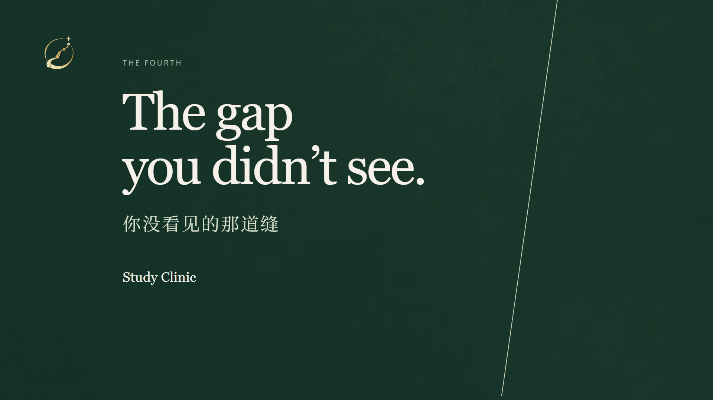

# Study Clinic 真实界面与展示

适用版本：V2（2.0.0）。

[首页](../README.md) · [产品与研究](REPORT.md) · [运行指南](SETUP.md)

本页使用B线2026-10-14采集的1920×1080真实页面。采集副本211个源码／资产／构建配置与已验收基线9ec6bde693455eac3df00e33984d9e0e0d9d8c93一致（Git LF/CRLF规范化）；运行数据库由SQLite online backup生成，主仓库与原用户库未写入。图片仅无损转换为WebP。[来源与哈希](media/v2/manifest.json)。

## 课程与连续状态

课程为离散数学，8模块、17Lesson、35必学知识、39目标，当前主动完成2课。明确知识范围和确认路线为长期学习提供可回看的安排。截图不是全课程学完；该原验收课程与研究中的32K冷启动课程不同。

## 阅读与来源

课文由真实MoMA / glm-5.3生成并保存，引用可展开。正文生成、来源身份和知识／目标定位分别检查，扫描原图与复杂公式仍有限。截图仅展示必要教材片段，未公开教材全文或可导入数据库。

## 答疑与变式练习

此图来自B线模拟操作者的新问题，真实MoMA答复进入独立revisit，保留原课堂。它展示条件变化和反例辨析，不构成学生学习效果研究。

该新题经独立解题和rubric核查后发布，包含方法选择与综合推理。截图为未提交题面，不能据此推断掌握程度。B线随后提供了历史真实MoMA的成功Repair/Retest；它与本次新题不是同一次作答链，分别说明。

## 结构变化与针对性补救

原题为p→q、q→r推出p→r；复测把第二前提换成r→q，原结论不再成立，需给p=T、q=T、r=F并检验两前提真而结论假。该2026-10-13真实MoMA链条来自可靠性隔离库，0%原误答与100%复测均为模拟学习者，不能解释为真实学生提分。旧评分附带错误措辞保留；这里只展示正确补救和结构变式，未宣称全文无误。

B本次新增模拟作答的三轮补救均未完成：第二课两轮题目准入失败，第一课一轮正文被必要核查拒绝；未发布为成功，与这条历史成功链不拼接。

## 正式支持与未实测

原用户验收记录中所选模块本次成绩100%，4条Evidence；未实测知识继续显示未实测。没有把模块成绩扩大为35个知识全部掌握，也没有测量提分。历史部分参考解答和LaTeX显示仍有内容／呈现限制，原记录不改写。

## 模型设置

Key仅显示已配置。“自动（auto）”表示同一模型按任务分配推理强度；[技术依据](REPORT.md#推理强度对照与任务分配)保留对照分母、失败和评价偏差。普通／长任务等待时间为实际保存的用户配置，并非所有新安装默认值。

## 《The Fourth》演示视频与公开方案

[观看／下载1080p视频](https://github.com/Small-fish-QAQ/hy3-study-clinic/releases/download/v2.0-mobile-cloud-cup-2026/Study-Clinic-The-Fourth-1080p.mp4) · [公开方案 PDF](https://github.com/Small-fish-QAQ/hy3-study-clinic/releases/download/v2.0-mobile-cloud-cup-2026/Study-Clinic-Design-V2.pdf) · [可编辑 PPT](https://github.com/Small-fish-QAQ/hy3-study-clinic/releases/download/v2.0-mobile-cloud-cup-2026/Study-Clinic-Design-V2.pptx)

本次里程碑选用《The Fourth》，200秒、1920×1080、30fps、H.264/AAC，中文画面字幕，无人声旁白。影片按原件发布，未再次压缩。22页方案使用官方模型应用赛模板，覆盖产品、MoMA接入与Prompt、工程与模型实测、成本和商业路径；公开版封面仅保留团队名称。

| 时间 | 展示内容 | 证据边界 |
| --- | --- | --- |
| 00:00–00:22 | 长期聊天学习的机制示意 | 明确标注为示意，非真实聊天记录 |
| 00:22–01:08 | Course Map、课文与来源 | 真实验收课程，35知识／17课规划不等于全部学完 |
| 01:08–01:38 | Tutor反例答疑 | 连续30秒原速实录，保留等待 |
| 01:38–02:04 | 67%练习与知识缺口 | 模拟学习者，不能作为学生提分证据 |
| 02:04–02:40 | 补救与结构变式 | 明确切换到2026-10-13另一条历史；100%不是67%的连续复测 |
| 02:40–03:02 | 自愿Formal与Evidence | 4条正式支持、31条未实测，不能外推整课掌握 |
| 03:02–03:20 | 刷新恢复与品牌落版 | 持久状态读回；书页为品牌装饰 |

新采集的三轮补救失败继续保留，影片选用另外的历史成功案例。41项来源与复制素材哈希一致，全片解码通过；[来源清单](media/v2/the-fourth-sources.json)与[媒体身份](media/v2/manifest.json)保留可复核记录。视频、PPT与PDF作为Release附件，原始录像、工程与缓存不进入源码仓库。

此前C线3分钟方案及封面保留为制作阶段记录，已由本片替代为本次正式Demo。犀牛鸟时期的Hy3演示与素材完整保留在[历史DEMO](https://github.com/Small-fish-QAQ/hy3-study-clinic/blob/task1-final-2026-09-14-r2/docs/DEMO.md)，旧媒体文件原位保留，旧结果不作为本次MoMA实测。

## 资源与许可

当前截图中的底层教材权利归相应权利人，本次公开范围为已审阅的必要产品展示片段；截图不授予教材再分发权。字体与图标声明见[第三方说明](../THIRD_PARTY_NOTICES.md)，原品牌／背景AI栅格素材和历史视频来源见[固定历史媒体说明](https://github.com/Small-fish-QAQ/hy3-study-clinic/blob/task1-final-2026-09-14-r2/docs/DEMO.md#资源与许可)。《The Fourth》使用原创72 BPM编曲、合成纸页声和GeneralUser GS 2.0.3乐器采样；[完整音源许可](media/v2/licenses/GeneralUser-GS-LICENSE.txt)允许私人及商业音乐创作，未分发音源库。Noto Sans SC与Noto Serif SC使用OFL许可；品牌装饰沿用已有素材。媒体许可说明另随Release附件提供，底层教材与官方模板标识不自动获得本项目Apache许可。
