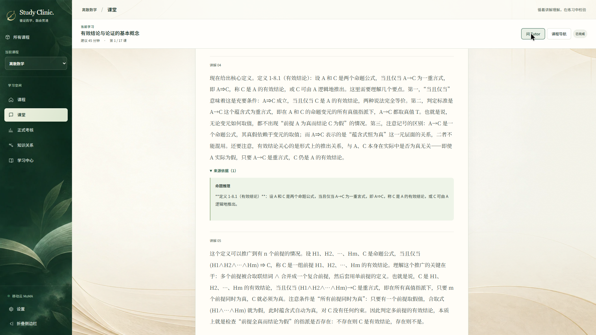
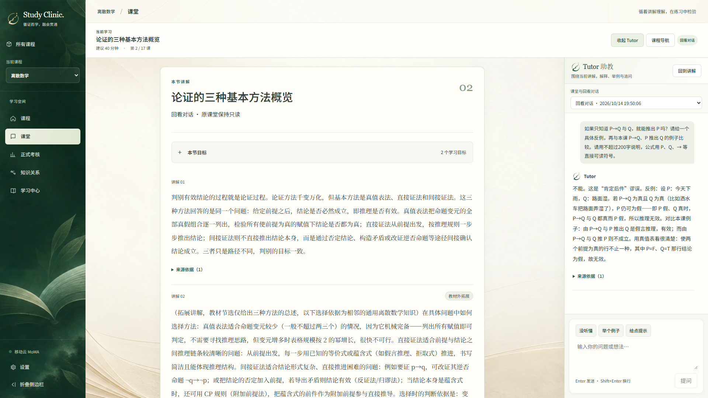
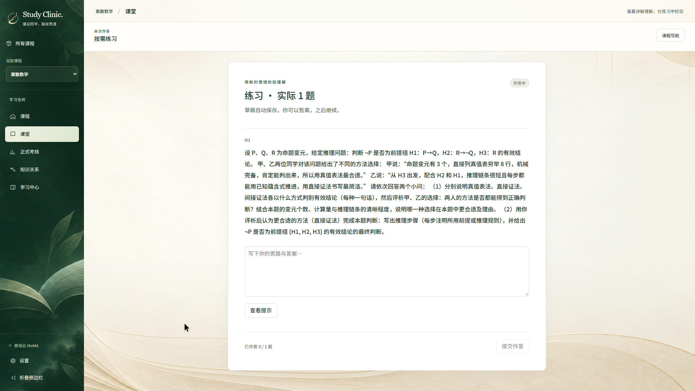
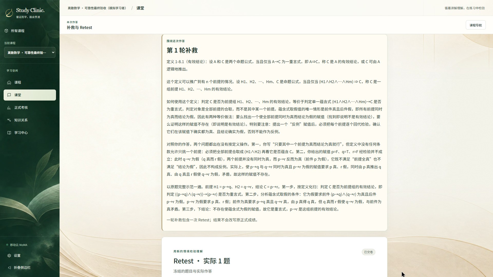
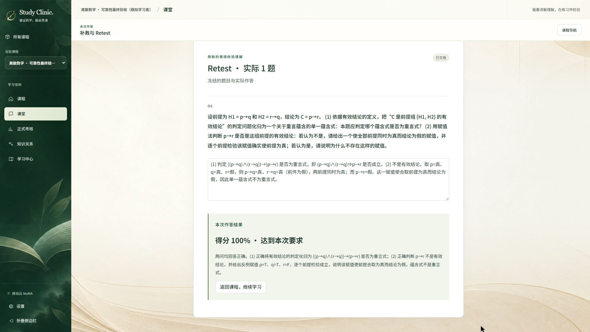
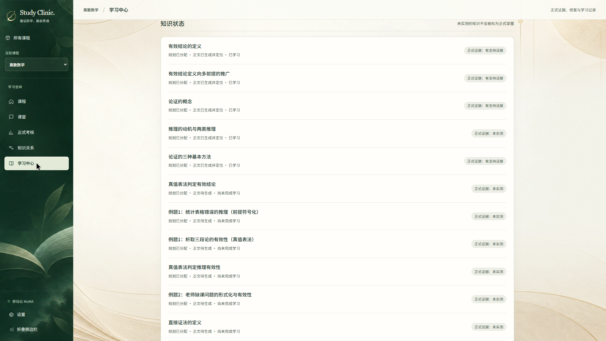

# Study Clinic 真实界面与展示

适用版本：V2（2.0.0）。

[首页](../README.md) · [产品与研究](REPORT.md) · [运行指南](SETUP.md)

本页使用B线2026-10-14采集的1920×1080真实页面。采集副本211个源码／资产／构建配置与已验收基线9ec6bde693455eac3df00e33984d9e0e0d9d8c93一致（Git LF/CRLF规范化）；运行数据库由SQLite online backup生成，主仓库与原用户库未写入。图片仅无损转换为WebP。[来源与哈希](media/v2/manifest.json)。

## 课程与连续状态

课程为离散数学，8模块、17Lesson、35必学知识、39目标，当前主动完成2课。明确知识范围和确认路线为长期学习提供可回看的安排。截图不是全课程学完；该原验收课程与研究中的32K冷启动课程不同。

## 阅读与来源

课文由真实MoMA / glm-5.3生成并保存，引用可展开。正文生成、来源身份和知识／目标定位分别检查，扫描原图与复杂公式仍有限。截图仅展示必要教材片段，未公开教材全文或可导入数据库。

## 答疑与变式练习

此图来自B线模拟操作者的新问题，真实MoMA答复进入独立revisit，保留原课堂。它展示条件变化和反例辨析，不构成学生学习效果研究。

该新题经独立解题和rubric核查后发布，包含方法选择与综合推理。截图为未提交题面，不能据此推断掌握程度。B线随后提供了历史真实MoMA的成功Repair/Retest；它与本次新题不是同一次作答链，分别说明。

## 结构变化与针对性补救

原题为p→q、q→r推出p→r；复测把第二前提换成r→q，原结论不再成立，需给p=T、q=T、r=F并检验两前提真而结论假。该2026-10-13真实MoMA链条来自可靠性隔离库，0%原误答与100%复测均为模拟学习者，不能解释为真实学生提分。旧评分附带错误措辞保留；这里只展示正确补救和结构变式，未宣称全文无误。

B本次新增模拟作答的三轮补救均未完成：第二课两轮题目准入失败，第一课一轮正文被必要核查拒绝；未发布为成功，与这条历史成功链不拼接。

## 正式支持与未实测

原用户验收记录中所选模块本次成绩100%，4条Evidence；未实测知识继续显示未实测。没有把模块成绩扩大为35个知识全部掌握，也没有测量提分。历史部分参考解答和LaTeX显示仍有内容／呈现限制，原记录不改写。

## 模型设置

Key仅显示已配置。auto是同一模型的任务级推理强度策略；[技术依据](REPORT.md#推理强度实验与-auto)保留对照分母、失败和评价偏差。普通／长任务等待时间为实际保存的用户配置，并非所有新安装默认值。

## 视频与历史演示

B已交付原速操作实录；C已交付3分钟、1920×1080、30fps的创意成片和中文字幕。本页封面与参赛成片的片尾已将产品名Study Clinic和版本V2（2.0.0）分开展示；修订成片保留原C交付，00:00–02:52实拍与机制示意沿用原时间线，最后8秒重渲染版本角标。封面使用现有品牌装饰，不代表真实课程状态。成片、字幕、素材清单及视频工程继续留在独立工作目录，成片已核对素材来源、版本对应和媒体解码，统一审阅后可将其作为GitHub Release附件。当前尚未发布视频，也未将大型影片或工程缓存纳入源码仓库。

视频区分真实操作、机制示意、模拟作答和2026-10-13历史变式案例；不能将本次67%作答接成历史100%复测，或把单次模块成绩称为整课掌握。具体文件身份与展示边界记在[媒体清单](media/v2/manifest.json)。

犀牛鸟时期的真实Hy3视频、截图、模拟作答和素材清单完整保留在[历史DEMO](https://github.com/Small-fish-QAQ/hy3-study-clinic/blob/task1-final-2026-09-14-r2/docs/DEMO.md)，旧媒体文件原位保留。旧视频不作为本次MoMA实测。

## 资源与许可

当前截图中的底层教材权利归相应权利人，必要片段的最终公开范围由用户确认；截图不授予教材再分发权。字体与图标声明见[第三方说明](../THIRD_PARTY_NOTICES.md)，原品牌／背景AI栅格素材和历史视频来源见[固定历史媒体说明](https://github.com/Small-fish-QAQ/hy3-study-clinic/blob/task1-final-2026-09-14-r2/docs/DEMO.md#资源与许可)。C成片采用原创程序合成配乐和中文画面字幕，无人声旁白；Noto字体按OFL保留许可，品牌书页为现有AI栅格装饰。详细音乐、字体与素材清单随仓库外的影片交付保留，封面来源见媒体清单。
